# Tactical X-Band Aerial Communication Network Digital Twin
## Comprehensive LLM Context & Architectural Master Specification

> **Target Audience:** Large Language Models (LLMs), AI pair-programmers, system architects, and simulation engineers.  
> **Repository:** `tactical-xband-digital-twin-main`  
> **Status:** Production Digital Twin Baseline (Phase 0 / Milestone M0.1 Verified).  
> **Domain:** Tactical Military Communications, Discrete-Event RF Simulation, TDMA MAC Scheduling, Topographic Radar Line-of-Sight (LOS) Analysis.

---

## 1. Executive Summary & Problem Domain

The **Tactical X-Band Air-to-Ground Network Digital Twin** simulates an airborne tactical relay network operating in high-relief mountainous topography (specifically calibrated to the **Himalayan / Ladakh Sector**, centered at $34.5^\circ\text{N}, 76.5^\circ\text{E}$).

### Core Tactical Scenario
- **Aerial Communication Node (ACN):** A tactical Medium-Altitude Long-Endurance (MALE) UAV or aircraft flying an orbit or waypoint loiter pattern at **5,000 m MSL** true altitude, equipped with an 8.0 GHz steerable array transmitter.
- **Master Command Post (MCP):** Node ID `15`, a high-power ground station equipped with a directional tracking dish antenna ($20\text{ dBi}$ gain, $43\text{ dBm}$ / $20\text{ W}$ PA).
- **Tactical Ground Terminals:** 15 dismounted soldier manpack nodes (Node IDs `0`–`14`) deployed throughout deep mountain valleys with whip antennas ($3\text{ dBi}$ gain, $36\text{ dBm}$ / $4\text{ W}$ PA).
- **Topographic Shadowing Challenge:** Rugged ridgelines cause severe knife-edge diffraction and hard shadow cutoff. In authentic Ladakh terrain, up to 15 of 16 ground terminals experience intermittent or sustained line-of-sight blockage as the ACN orbits.
- **The Core Scientific Comparison:**
  - **Legacy Static TDMA:** Divides uplink superframe into rigid, equal-sized time slots round-robin regardless of RF link viability. Terminals blocked by mountain ridges still dequeue packets and radiate into rock, wasting airtime and causing catastrophic packet drops.
  - **Terrain-Aware Dynamic Scheduler (Tac-TAD):** Evaluates real-time and predictive line-of-sight status, filters out severed links, boosts nodes about to enter occlusion ($\Phi_{\text{evac}}$ up to $5.0\times$), weights traffic by 3GPP 5QI urgency and Proportional Fairness, and allocates exact-fit time slots ($\tau_i = Q_i / R_i$), achieving **zero wasted bits on outage** and superior goodput.

---

## 2. System Architecture & Concurrency Model

```mermaid
flowchart TD
    subgraph UI_Thread["Main UI Thread (Browser / Electron)"]
        UI_Shell["App Shell & Navigation (index.html)"]
        MapLibre["MapLibre GL (2D Geospatial Map & Hillshade)"]
        ThreeJS["Three.js Engine (3D Tactical Battlefield View)"]
        CanvasRadar["Canvas 2D (Radar & RF Path Profile Viewports)"]
        StateBuffer["Historical Coordinator (60s Telemetry Ring Buffer)"]
    end

    subgraph Worker_Thread["Authoritative Background Web Worker (simWorker.ts)"]
        SimLoop["50 Hz Discrete-Event Loop (dt = 0.020s)"]
        TrajectoryEng["Trajectory & Kinematics Engine"]
        LookAheadEng["Predictive Look-Ahead Machine"]
        TerrainEng["TerrainEngine (Ray-Marching & DEM)"]
        LinkBudgetEng["LinkBudgetEngine (ITU-R Models)"]
        TrafficQueues["Traffic Generator & FQ-CoDel Queues"]
        DualScheduler["Dual Schedulers (Static TDMA vs. Tac-TAD)"]
        TransferMgr["Active Mission Bulk Transfer FSM"]
        DeterminismTracer["IEEE-754 Canonical State-Hash Engine"]
    end

    UI_Shell -->|"WorkerInboundCommand (IPC postMessage)"| SimLoop
    SimLoop -->|"WorkerOutboundMessage / TelemetryFrame"| UI_Shell
    UI_Shell --> MapLibre
    UI_Shell --> ThreeJS
    UI_Shell --> CanvasRadar
    UI_Shell --> StateBuffer
```



### 2.1 Concurrency & Invariants
1. **Single Source of Truth:** All mutable simulation state (positions, velocities, battery levels, packet queues, trajectory definitions, slot allocations) lives exclusively in the background Web Worker (`src/worker/simWorker.ts`).
2. **Main Thread Read-Only Projection:** The main UI thread maintains only a read-only projection (`latestTelemetryFrame`). It never mutates simulation models directly; it issues strongly-typed `WorkerInboundCommand` messages.
3. **Dual-Thread Terrain Separation:**
   - **Worker Thread (`TerrainEngine`):** Executes 50 Hz ray-marching, knife-edge diffraction, and predictive look-ahead.
   - **Main Thread (`mainTerrainEngine`):** Drives 60 FPS interactive tactical cursor readouts and HGT mosaic preview stitching.
4. **Authoritative Engine:** The TypeScript engine under `src/` is the sole authoritative simulation runtime. The Python implementation under `core/` and `server/` is a legacy reference prototype.

---

## 3. Directory Layout & Module Responsibilities

```
tactical-xband-digital-twin-main/
├── core/                         # [Legacy Prototype] Python simulation engine
│   ├── config.py                 # RF and kinematic dataclasses
│   ├── link_budget.py            # Python Friis / ITU-R models
│   ├── queues.py                 # Python priority queues
│   ├── scheduler.py              # Python Static & Tac-TAD schedulers
│   ├── terrain.py                # Python DEM interpolator & synthetic generator
│   └── trajectory.py             # Python kinematics & lookahead
├── server/
│   └── app.py                    # Legacy FastAPI + WebSocket telemetry server
├── src/                          # [AUTHORITATIVE] Modern TypeScript Engine
│   ├── core/                     # Pure domain logic (zero DOM/browser dependencies)
│   │   ├── config.ts             # RFConfig, EnvironmentConfig, ACNFlightConfig
│   │   ├── geodesy.ts            # WGS-84 Plate Carrée forward/inverse projections
│   │   ├── hgtMosaic.ts          # Multi-tile SRTM HGT mosaic stitcher
│   │   ├── hgtParser.ts          # Binary SRTM .hgt parser (big-endian Int16)
│   │   ├── linkBudget.ts         # FSPL, ITU-R P.676, P.838, DVB-S2X MODCOD table
│   │   ├── linkProfile.ts        # 1D line-of-sight elevation sampler
│   │   ├── linkStatusClassifier.ts # 6-state tactical link status classifier
│   │   ├── nodeRegistry.ts       # Dynamic ground node entities, AGL, UUIDs
│   │   ├── obstacles.ts          # 3D spatial obstacles (cuboid, cone, pyramid)
│   │   ├── profileEngine.ts      # Profile caching & decimation engine
│   │   ├── queues.ts             # 3GPP 5QI packet models & FQ-CoDel priority queue
│   │   ├── registration.ts       # Node network join/leave lifecycle state machine
│   │   ├── rollingGoodput.ts     # P50/P95 rolling percentile estimators
│   │   ├── scheduler.ts          # Static TDMA & Tac-TAD dynamic schedulers
│   │   ├── terrain.ts            # TerrainEngine, ray-marcher, DEM bounds, hillshade
│   │   ├── trajectory.ts         # ACN elliptical & waypoint kinematics, 4-state lookahead
│   │   ├── transferManager.ts    # Multi-node mission transfer state machine (SOS/Photo/Video)
│   │   ├── transferMetrics.ts    # Goodput, delivered bytes, drop accounting
│   │   └── waypoints.ts          # Closed-loop waypoint path validation
│   ├── shared/                   # Cross-boundary primitives (Worker <-> Host)
│   │   ├── constants.ts          # FRAME_DT (0.020s), THEATER_HALF_M (600km), MCP_ID (15)
│   │   ├── types.ts              # Position3D, common interfaces
│   │   ├── utils.ts              # isFiniteNumber, clamp
│   │   └── workerProtocol.ts     # Inbound & outbound IPC message schemas
│   ├── worker/                   # Background Web Worker execution
│   │   ├── hillshadeGenerator.ts # 2D Lambertian shaded-relief generator
│   │   ├── nodeLifecycleManager.ts# Add/delete/duplicate/update ground node pool
│   │   ├── simWorker.ts          # SimulationWorkerManager 50 Hz discrete loop
│   │   ├── telemetrySerializer.ts# Compact JSON/typed telemetry frame serializer
│   │   └── terrainMeshGenerator.ts# Three.js heightfield buffer geometry builder
│   ├── ui/                       # Main thread UI controllers & view engines
│   │   ├── commandResultRouter.ts# Async worker command ACK/rejection router
│   │   ├── dataCommVisualization.ts# Canvas data-comm Gantt chart & metrics graphs
│   │   ├── historicalSessionCoordinator.ts # Telemetry session manager
│   │   ├── linkProfileViewport.ts# Canvas RF Fresnel zone profile visualizer
│   │   ├── mapLinkStyles.ts      # 6 tactical link style definitions (color/dash)
│   │   ├── networkPerformanceDashboard.ts # KPI dashboard widgets
│   │   ├── networkTrafficInventory.ts # Per-node traffic rate & backlog table
│   │   ├── nodeAglController.ts  # Above Ground Level (AGL) height slider controller
│   │   ├── nodeInventory.ts      # Node list, selection & lifecycle UI
│   │   ├── obstacleEditorState.ts# Interactive obstacle placement state
│   │   ├── pathProfileTopView.ts # Top-down RF beam path profile view
│   │   ├── radarCursorReadout.ts # Live cursor terrain elevation & coordinate readout
│   │   ├── schedulerHistory.ts   # Historical scheduler Gantt replay
│   │   ├── simulationHistory.ts  # 60s ring buffer telemetry store
│   │   ├── terrainMapRenderer.ts # MapLibre GL layer manager
│   │   ├── trajectoryEditorState.ts # Waypoint / orbit editor controller
│   │   └── three/                # Three.js 3D Battlefield View
│   │       ├── sceneManager.ts   # WebGLRenderer, OrbitControls, camera rigs
│   │       ├── tacticalEntityManager.ts # 3D ACN aircraft, soldier masts, animated RF beams
│   │       ├── terrainBuilder.ts # Dynamic 3D terrain mesh generation from DEM
│   │       └── threeTypes.ts     # Three.js scene configuration contracts
│   └── tests/                    # 33 Verification & determinism test suites
├── public/terrain/
│   └── real_ladakh_dem.bin       # Authentic 512x512 Float32 elevation matrix (1 MB)
├── scripts/
│   ├── pack_context.py           # Codebase context packager for LLMs
│   ├── run_all_verifications.mjs # 33-suite master verification test runner
│   ├── run_ts_benchmark.ts       # Headless paired-scheduler benchmark (Schema 1.3)
│   └── verify-project.mjs        # Repository structure & architectural assertion suite
├── electron/
│   └── main.cjs                  # Electron desktop application entry point
├── index.html                    # Unified tactical C2 operational console UI
└── package.json                  # Scripts & toolchain dependencies
```

---

## 4. Key Mathematical & Physical Models

### 4.1 Radio Frequency (RF) & Propagation Link Budget (`src/core/linkBudget.ts`)

| Parameter | Symbol / Formula | Nominal Value |
| :--- | :--- | :--- |
| **Carrier Frequency** | $f_c$ | $8.0\text{ GHz}$ (Tactical X-Band, $\lambda \approx 0.03747\text{ m}$) |
| **Channel Bandwidth** | $B$ | $1.0\text{ MHz}$ |
| **ACN Transmit Power / Gain** | $P_{\text{tx, ACN}} / G_{\text{tx, ACN}}$ | $40.0\text{ dBm}$ ($10\text{ W}$) / $15.0\text{ dBi}$ |
| **Soldier Transmit Power / Gain** | $P_{\text{tx, Soldier}} / G_{\text{tx, Soldier}}$ | $36.0\text{ dBm}$ ($4\text{ W}$) / $3.0\text{ dBi}$ |
| **MCP Transmit Power / Gain** | $P_{\text{tx, MCP}} / G_{\text{tx, MCP}}$ | $43.0\text{ dBm}$ ($20\text{ W}$) / $20.0\text{ dBi}$ |
| **Receiver Noise Figure** | $NF$ | $5.0\text{ dB}$ |
| **Implementation / Cable Loss** | $L_{\text{impl}} / L_{\text{cable}}$ | $2.5\text{ dB} / 1.5\text{ dB}$ |

#### 1. Free Space Path Loss (FSPL)
$$\text{FSPL}(\text{dB}) = 20\log_{10}(d) + 20\log_{10}(f_c) + 20\log_{10}\left(\frac{4\pi}{c}\right)$$

#### 2. Atmospheric & Rain Attenuation (ITU-R P.676 & P.838)
- **Gaseous Absorption:** $\gamma_g = 0.012\text{ dB/km}$ at $8.0\text{ GHz}$ in alpine air:
  $$L_{\text{gas}} = 0.012 \times \frac{d}{1000}$$
- **Specific Rain Attenuation:** $k_H = 0.00411, \alpha_H = 1.390$:
  $$\gamma_R = k_H \cdot (R_{\text{rain}})^{\alpha_H}\quad (\text{dB/km})$$
  $$L_{\text{rain}} = \gamma_R \times \min\left(\frac{d}{1000}, L_{\text{cell}}\right)$$

#### 3. Receiver Thermal Noise Floor
$$P_{\text{noise}}(\text{W}) = k_B \cdot T \cdot B \cdot 10^{NF/10}$$
$$P_{\text{noise}}(\text{dBm}) = 10\log_{10}(P_{\text{noise}}\times 1000) \approx -108.97\text{ dBm}$$

#### 4. DVB-S2X / 3GPP Rel-17 NTN 8-State MODCOD Table
| MODCOD Name | Min SNR ($dB$) | Spectral Efficiency ($\text{bps/Hz}$) | Bitrate ($B=1.0\text{ MHz}$) |
| :--- | :---: | :---: | :---: |
| `64-APSK 5/6` | $22.0$ | $4.95$ | $4.95\text{ Mbps}$ |
| `32-APSK 3/4` | $17.5$ | $3.70$ | $3.70\text{ Mbps}$ |
| `16-APSK 4/5` | $14.0$ | $3.16$ | $3.16\text{ Mbps}$ |
| `16-APSK 2/3` | $11.5$ | $2.64$ | $2.64\text{ Mbps}$ |
| `8-PSK 3/5` | $8.0$ | $1.78$ | $1.78\text{ Mbps}$ |
| `QPSK 3/4` | $5.5$ | $1.49$ | $1.49\text{ Mbps}$ |
| `QPSK 1/2` | $2.5$ | $0.99$ | $0.99\text{ Mbps}$ |
| `pi/2-BPSK 1/3` | $-1.5$ | $0.33$ | $0.33\text{ Mbps}$ |
| *Outage* | $< -1.5$ | $0.00$ | $0.00\text{ Mbps}$ |

---

### 4.2 Topographic Line-of-Sight & Diffraction (`src/core/terrain.ts`)

- **Effective Earth Curvature (ITU-R P.834):** $k = 4/3$, $R'_e = k \cdot R_e = \frac{4}{3} \cdot 6,371,000\text{ m} \approx 8,494,667\text{ m}$.
- **First Fresnel Zone Radius:** At sample point distance $d_1$ from transmitter and $d_2$ from receiver:
  $$r_1 = \sqrt{\frac{\lambda \cdot d_1 \cdot d_2}{d_1 + d_2}}$$
- **Knife-Edge Dimensionless Parameter $v$ (ITU-R P.526):**
  $$v = -h_{\text{clearance}} \cdot \sqrt{\frac{2}{\lambda}\left(\frac{1}{d_1} + \frac{1}{d_2}\right)}$$
- **Diffraction Loss Approximation:**
  $$J(v) = 6.9 + 20\log_{10}\left(\sqrt{(v - 0.1)^2 + 1} + v - 0.1\right) + 12.0\text{ dB (Fock rounded crest)}$$
  If $v \le -0.78$, $J(v) = 0\text{ dB}$ (unobstructed line-of-sight).

---

### 4.3 Multi-Class Traffic & Queues (`src/core/queues.ts`)

3GPP Mission Critical (MCX) 5QI Traffic Profiles:
1. **5QI 69 (Emergency C2 / SOS):** Priority 1 (highest), Packet Delay Budget $PDB = 60.0\text{ s}$, size $128\text{ bytes}$, max queue ceiling 120 packets.
2. **5QI 65 (MC-PTT Tactical Voice):** Priority 2, $PDB = 75\text{ ms}$, size $160\text{ bytes}$.
3. **5QI 67 (MC Tactical Video):** Priority 3, $PDB = 150\text{ ms}$, size $1,200\text{ bytes}$.
4. **5QI 70 (Tactical Recon Photo / Sensor):** Priority 4, $PDB = 500\text{ ms}$, size $1,400\text{ bytes}$.

**Queue Discipline:** Bounded Strict-Priority Multi-Class Queue with Head-of-Line (HOL) sojourn tracking. When packet sojourn exceeds its $PDB$, it is pruned with a delay drop (`packetsDroppedDelay`). When buffer limit (400 packets) is exceeded, non-C2 packets drop with an overflow drop (`packetsDroppedOverflow`).

---

### 4.4 Schedulers: Static TDMA vs. Tac-TAD (`src/core/scheduler.ts`)

#### Superframe Structure ($\Delta t = 20.0\text{ ms}$, $50\text{ Hz}$)
$$T_{\text{frame}} = 20\text{ ms} = T_{\text{ctrl}} (1\text{ ms}) + T_{\text{dl}} (3\text{--}7\text{ ms}) + T_{\text{ul}} (16\text{ ms})$$
Timing advance guard between slots: $\tau_{\text{guard}} = 12.0\ \mu\text{s}$. Minimum allocatable slot: $\tau_{\text{min}} = 200\ \mu\text{s}$.

#### 1. Legacy Static TDMA
Divides available uplink time equally among all $N$ nodes:
$$\tau_{\text{slot}} = \frac{T_{\text{ul, avail}} - N \cdot \tau_{\text{guard}}}{N}\quad (\text{exactly } 988\ \mu\text{s for } N=16)$$
- If a terminal is occluded, packets are dequeued into an unusable link $\rightarrow$ **wasted bits on outage**.

#### 2. Tac-TAD (Terrain-Aware Dynamic Scheduler)
1. **Outage Reclamation:** Immediately filters out any terminal with zero bitrate, hard shadow cutoff, outage, or depleted battery. Time that would have been wasted is reclaimed into the common uplink pool.
2. **Lyapunov Composite Urgency Metric ($\Psi_i$):**
   $$\Psi_i = \Phi_{\text{evac}, i} \times U_i \times \text{PF}_i \times \log_2\left(1 + \frac{Q_i}{8000}\right) \times w_{\text{prio}, i}$$
   - **Urgency ($U_i$):** $U_i = \sum_{q \in \{69,65,67,70\}} w_q \exp\left(\min\left(8.0, \frac{\text{HOL}_q}{\text{PDB}_q}\right)\right)$ where weights are $w_{69}=200, w_{65}=50, w_{67}=2, w_{70}=1$.
   - **Proportional Fairness ($\text{PF}_i$):** $\text{PF}_i = \frac{R_{\text{inst}, i}}{\max(1000, R_{\text{avg}, i})}$.
   - **Predictive Evacuation Surge ($\Phi_{\text{evac}, i}$):**
     - In `PRE_OCCLUSION_FLUSH`: $\Phi_{\text{evac}} = 1.0 + 5.0 \cdot \left(\frac{3.0 - t_{\text{occ}}}{3.0}\right) \cdot \min\left(1.0, \frac{Q}{20000}\right)$ (up to $6.0\times$ surge).
     - In `RE_EMERGENCE_BURST`: $\Phi_{\text{evac}} = 4.0$.
3. **Exact-Fit Dynamic Slot Sizing:**
   $$\tau_i = \min\left(\tau_{\text{max}}, \max\left(\tau_{\text{min}}, \frac{Q_i}{R_{\text{inst}, i}}\right)\right)$$
   Only dequeues what can be transmitted. Zero bits dequeued into outage.

---

### 4.5 Flight Kinematics & 4-State Look-Ahead Machine (`src/core/trajectory.ts`)

- **Constant Airspeed Kinematics:** True airspeed $v = 60.0\text{ m/s}$ ($216\text{ km/h}$). Acceleration / deceleration limits: $5.0\text{ m/s}^2$. Analytic integration provides exact $O(1)$ spatial continuity during speed transitions.
- **Flight Trajectory Modes:**
  1. `ellipse`: Racetrack inclined orbit ($a=20\text{ km}, b=10\text{ km}, \theta=35^\circ$).
  2. `waypoints`: Arbitrary closed-loop polygon (up to 64 waypoints, validated closed path).
- **4-State Predictive Occlusion Machine:**
  - `NORMAL_LOS`: Link is clear, clearance $> 0.6 F_1$.
  - `PRE_OCCLUSION_FLUSH`: Raycast lookahead detects terrain obstruction within 3.0 seconds ($t_{\text{occ}} \le 3.0\text{ s}$). Triggers urgent queue evacuation.
  - `HARD_SHADOW_CUTOFF`: Line-of-sight severed by terrain ridge. Schedulers halt transmission.
  - `RE_EMERGENCE_BURST`: Lookahead predicts clearance emergence within 1.0 second. Buffers prepare burst transmission.

---

### 4.6 Authentic Terrain & Geodesy (`src/core/terrain.ts`, `geodesy.ts`)

- **Calibrated Asset:** `public/terrain/real_ladakh_dem.bin`
  - $512 \times 512$ single-precision IEEE-754 floats ($1,048,576\text{ bytes}$).
  - Canonical SHA-256 Checksum: `db042461396eab173f3d84d822233f3dc20010a03907d4f4ef358cd565215d96`.
- **WGS-84 Plate Carrée Projection:**
  - Origin $(0, 0) \longleftrightarrow 34.500000^\circ\text{N}, 76.500000^\circ\text{E}$.
  - Meridional scale: $110,931.4506\text{ m / deg Lat}$.
  - Parallel scale: $91,839.9774\text{ m / deg Lon}$.
  - Bounded coverage: Lat $[33.5^\circ, 35.5^\circ]$, Lon $[75.5^\circ, 77.5^\circ]$.

---

## 5. WebWorker IPC Message Protocol (`src/shared/workerProtocol.ts`)

### Inbound Commands (`WorkerInboundCommand`: Host $\rightarrow$ Worker)
- `SIM_CONTROL`: `{ action: 'play' | 'pause' | 'step' | 'reset' }`
- `SET_SPEED`: `{ speed: number, target_speed?: number }`
- `SET_SCHEDULER`: `{ scheduler: 'static' | 'dynamic' }`
- `SELECT_NODE`: `{ node_id: number }`
- `NODE_MOVE`: `{ node_id: number, x_m: number, y_m: number, z_m?: number }`
- `NODE_ADD`: `{ name: string, node_type: NodeType, x_m: number, y_m: number, agl_m?: number }`
- `NODE_DELETE`: `{ node_id: number }`
- `NODE_DUPLICATE`: `{ source_node_id: number }`
- `NODE_UPDATE`: `{ node_id: number, agl_m?: number, traffic_rate_kbps?: number, ... }`
- `OBSTACLES_REPLACE`: `{ obstacles: readonly Obstacle[] }`
- `CONFIG_UPDATE`: `{ rf_config?: Partial<IRFConfig>, flight_config?: Partial<IACNFlightConfig> }`
- `INJECT_TRAFFIC`: `{ node_id: number, type: 'SOS' | 'PHOTO' | 'VIDEO' | 'VOICE' }`
- `SET_TERRAIN_MODE`: `{ mode: 'real' | 'synthetic' }`
- `LOAD_CUSTOM_DEM`: `{ buffer: ArrayBuffer, metadata?: DemGeographicMetadata }`

### Outbound Messages (`WorkerOutboundMessage`: Worker $\rightarrow$ Host)
- `TELEMETRY_FRAME`: Sent every 20 ms containing full `TelemetryFrame` (ACN telemetry, all 16 node statuses, Gantt slot allocations, comparative KPI dashboard, active transfers).
- `PROFILE_FRAME`: High-resolution 80-sample Fresnel cross-section for selected node.
- `HILLSHADE_READY`: $512 \times 512$ shaded relief raster for MapLibre layer rendering.
- `TERRAIN_BOUNDS_READY`: Spatial bounding coordinates.
- `TERRAIN_MESH_DATA_READY`: `Float32Array` elevation grid for Three.js 3D terrain builder.
- `COMMAND_RESULT`: Acceptance/rejection ACK for asynchronous mutations.

---

## 6. Determinism & Verification Infrastructure

### Determinism State-Hash Engine (`src/tests/helpers/simulationTrace.ts`)
The engine enforces IEEE-754 bit-exact simulation determinism. All floating-point telemetry values are converted to 16-character hexadecimal strings (`float64ToCanonicalHex`) with $-0.0$ canonicalized to $+0.0$ and hashed with SHA-256.
- **Reference Hashes:** Documented in `docs/PHASE_0_BASELINE.md` for both synthetic and real Ladakh terrain modes.
- **Verification Suite:** `src/tests/verifyDeterminismTrace.ts` executes Tests T1–T6 to guarantee that state evolutions are identical across platforms and replays.

### Master Verification Harness
```bash
npm run verify:all    # Executes all 33 registered test suites
npm run typecheck     # Static TypeScript non-strict validation
npm run verify:project# Verifies 19 structural repository assertions
npm run benchmark:ts  # Runs headless 500-frame paired benchmark (Schema 1.3)
```

---

## 7. Operational Guidelines for Future Development

1. **Do Not Break Determinism:** Any modification to `simWorker.ts`, `scheduler.ts`, `queues.ts`, `terrain.ts`, or `linkBudget.ts` must pass `node node_modules/.bin/vite-node src/tests/verifyDeterminismTrace.ts`.
2. **Never Fabricate Elevations:** If a coordinate falls outside DEM coverage, return genuine fallback or mark `isWithinCoverage: false`. Never invent synthetic elevations at real geographic coordinates.
3. **Respect Dual-Thread Boundaries:** UI components under `src/ui/` must never import worker internals directly; communicate exclusively via `WorkerInboundCommand`.
4. **Preserve Metric Definitions:**
   - `goodput_bits`: Bits dequeued while link is usable.
   - `totalPayloadBitsDequeued`: All bits removed from queue.
   - `totalBitsWastedOnOutage`: Bits dequeued into severed link.
   - For Tac-TAD, `totalBitsWastedOnOutage` is strictly $0$ by construction.
